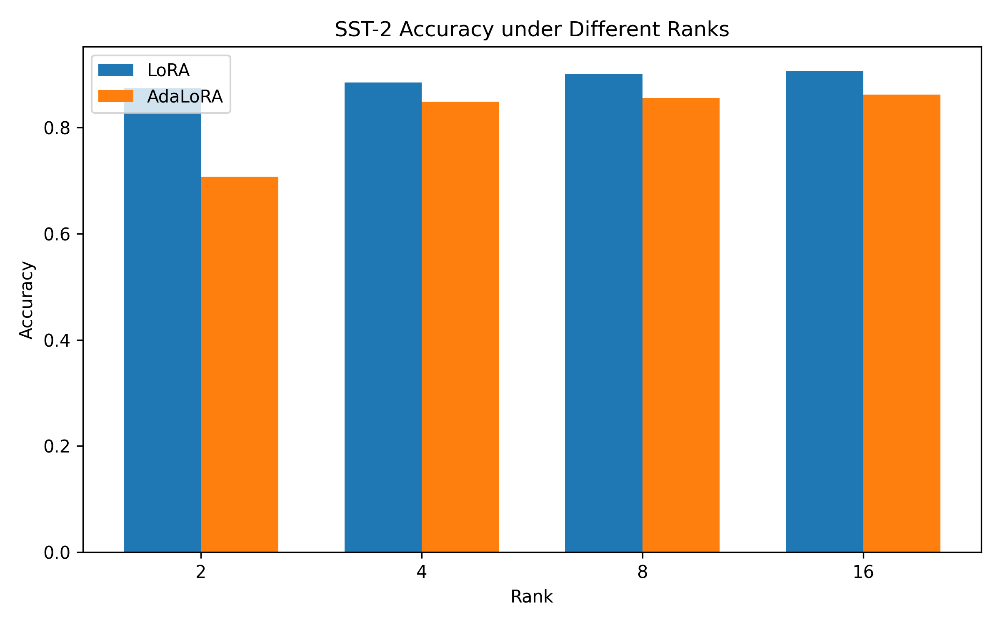
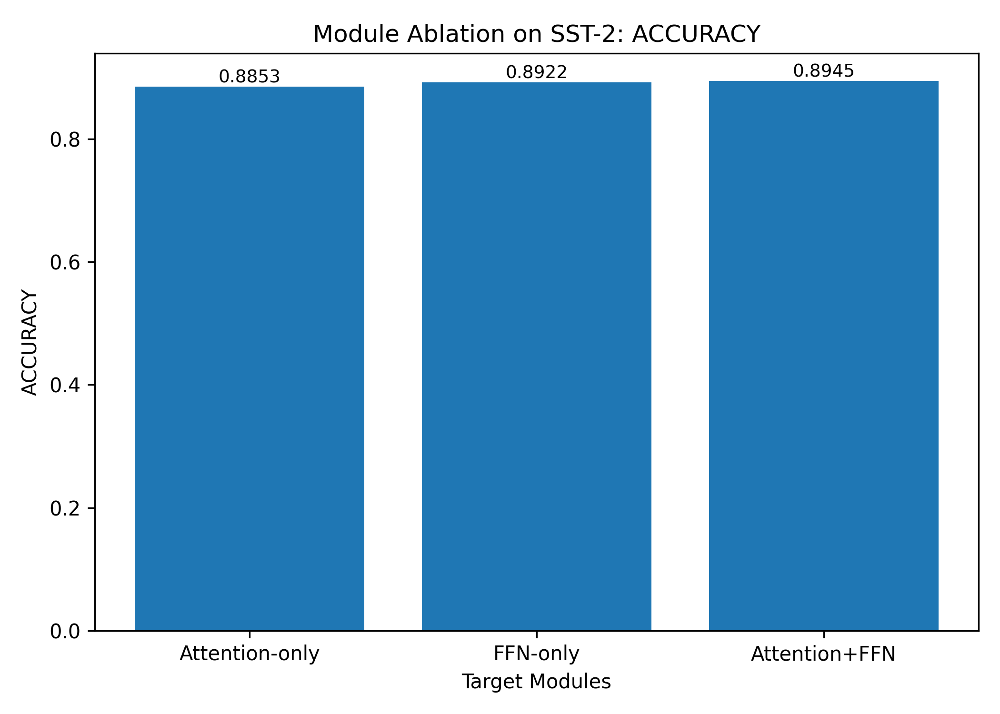

# LoRA / AdaLoRA 参数高效微调实验

中文信息处理课程小组项目，以 `bert-base-uncased` 和 GLUE 的 SST-2、MRPC、RTE 为实验对象，对比 LoRA 与 AdaLoRA 的性能、参数效率、模块消融和动态 rank 分配。当前语料是英文任务，模型是 BERT；本仓库保存实验代码、配置和历史结果。

## 我的工作

负责实验结果的整理、分析与展示材料：

- 汇总 MRPC、RTE 多任务结果，核对跨任务表现。
- 整理 Attention-only、FFN-only、Attention+FFN 消融结果，核对每万参数 Accuracy 等衍生指标。
- 分析 query/value 重要性差异及其与有效 rank 的相关性。
- 撰写模块消融、重要性评分验证及核心结论摘要。

项目当前的展示层由图表、Markdown 报告和命令行入口组成，没有单独的 Web 前端。核心训练、可视化脚本和统一入口属于团队协作成果，详见 [团队分工与来源](docs/SOURCES.md)。

## 实验结果

以下是提交材料中的历史验证集结果，本次仓库整理未重新训练。多数配置使用 `seed=42`，结果不代表多随机种子统计或 GLUE 官方测试榜单。

| 任务 | 实验 | Accuracy | F1 |
| --- | --- | ---: | ---: |
| SST-2 | LoRA r=16，3 epoch | 0.907110 | 0.909295 |
| MRPC | LoRA r=4，3 epoch | 0.828431 | 0.880952 |
| RTE | LoRA r=4，3 epoch | 0.570397 | 0.489270 |

具体结果以 [metrics.csv](results/metrics/metrics.csv) 与 [核心结论摘要](reports/summary/核心结论摘要.md) 为准。AdaRank Score 是项目自定义综合评分，不是通用评测指标。





## 快速查看已有结果

无需下载模型即可阅读 `reports/`、`results/figs/` 与指标 CSV。查看文件状态也无需第三方包：

```bash
python scripts/run_tool.py --mode status
```

## 安装与复现

原材料记载 Python 3.11.9，但未提供完整版本锁文件。新增依赖清单依据源码导入整理，版本范围是安装起点，不宣称为原实验环境；新的 Transformers/PEFT 组合需要先验证小样本训练。

在仓库根目录创建 Python 3.11 环境：

```powershell
py -3.11 -m venv .venv
.\.venv\Scripts\python.exe -m pip install -r requirements.txt
# 先运行小样本配置（同样会下载基础模型和数据集）
.\.venv\Scripts\python.exe scripts/run_tool.py --mode train --script train02 --config sst2_lora4
# 三轮正式训练
.\.venv\Scripts\python.exe scripts/run_tool.py --mode train --script train02 --config sst2_lora4_e3
```

PyTorch 的 CPU/CUDA 版本按实际设备选择；首次训练需要访问 Hugging Face 下载模型与 GLUE 数据集。模型缓存、输出权重和 TensorBoard 日志不提交；历史训练曲线 CSV 保留用于结果展示。

仅处理已有数据，可安装分析依赖并生成图表：

```bash
python -m pip install -r requirements-analysis-tested.txt
python scripts/run_tool.py --mode show --name multitask
python scripts/run_tool.py --mode show --name ablation
python scripts/run_tool.py --mode all_report
```

图表与报告命令会重写对应结果文件；训练会向 `results/metrics/metrics.csv` 追加记录。开展新实验前保留原结果副本，避免混淆历史结果与新结果。

## 目录与实验线

| 目录 | 内容 |
| --- | --- |
| `configs/` | 基线、多任务、消融、动态 rank 与预算调度配置 |
| `scripts/train/` | 训练实现；`train03` 为早期诊断尝试，`train05` 为严格动态秩版本 |
| `scripts/visualize/` | 结果对比与诊断图表 |
| `scripts/report/` | 评分、报告汇总与策略建议 |
| `src/` | Hugging Face 接口兼容处理 |
| `results/` | 历史指标、rank、重要性、评分和结果图 |
| `reports/` | 结论、实验表、生成报告 |

完整命令参考见 [实验手册](docs/EXPERIMENT_GUIDE.md)，本次整理的验证范围见 [VALIDATION.md](docs/VALIDATION.md)。
